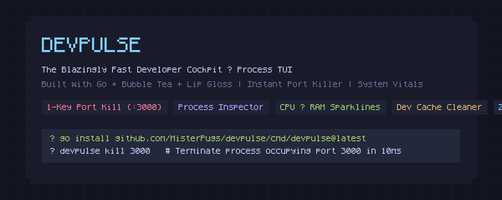
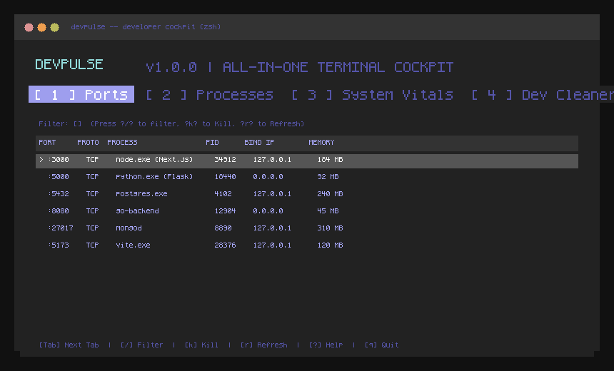
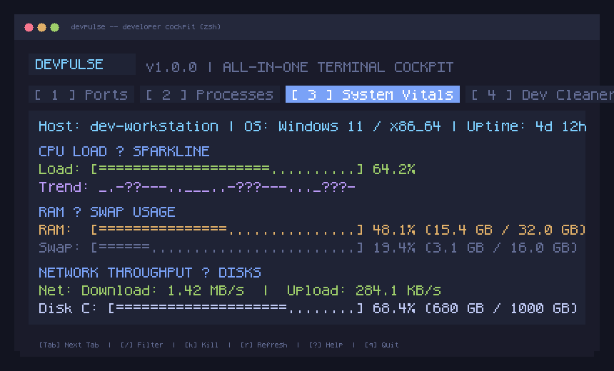
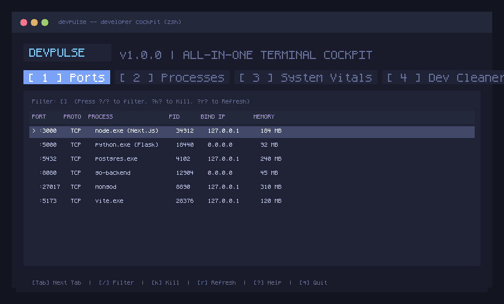

<div align="center">



# ⚡ DevPulse

### The Blazingly Fast All-in-One Developer Cockpit & Process TUI

[](https://golang.org)
[](LICENSE)
[](https://github.com/MisterPugs/devpulse)
[](CONTRIBUTING.md)
[](https://github.com/charmbracelet/bubbletea)

<br />

**DevPulse** is a lightweight, zero-dependency terminal dashboard crafted with **Go**, **Bubble Tea**, and **Lip Gloss**.  
It eliminates the daily friction of zombie development servers locking `:3000` or `:8080`, runaway Node.js/Python memory leaks, and disk space vanishing into bloated `node_modules`.

<br />

<!-- Animated Demo GIF -->


</div>

---

## 🌟 Why DevPulse?

Every developer experiences this multiple times a day:
- *"Error: listen EADDRINUSE: address already in use :::3000"* 🤬
- Searching StackOverflow for `netstat -ano | findstr 3000` or `lsof -i :8080 | awk '{print $2}' | xargs kill -9`.
- Chrome or a zombie Docker container consuming 95% of your RAM without you noticing.
- Your SSD filling up because 20 old tutorial repos contain 30 GB of forgotten `node_modules` and `target` folders.

**DevPulse fixes all of this in a unified, beautiful terminal cockpit.**

---

## ✨ Features at a Glance

| Feature | Description |
| :--- | :--- |
| 🔌 **1-Key Port Terminator** | Instantly inspect all active listening ports and terminate stuck processes (`:3000`, `:8080`, `:5432`) with a single keystroke (`k` or `x`). |
| 🚀 **Developer Process Monitor** | Real-time CPU, RAM, and command-line monitoring sorted dynamically by CPU, memory, or PID. |
| 📊 **Real-Time System Vitals** | High-precision Unicode sparkline graphs (` ▂▃▄▅▆▇█`), RAM/Swap gauges, mounted disk stats, and live network I/O speeds. |
| 🧹 **Workspace Dev Cleaner** | Deep-scans your workspace for `node_modules`, `.next`, `target`, `.venv`, and cache folders. Select and wipe them with confirmation to reclaim gigabytes of storage. |
| ⚡ **Sub-Millisecond CLI Mode** | Want a fast headless kill without launching the TUI? Run `devpulse kill 3000` for an instant 10ms termination. |
| 🎨 **Tokyo Night Cyberpunk UI** | Gorgeous color palettes powered by Lip Gloss with responsive auto-resizing. |

---

## 📸 Screenshots & Showcase

<div align="center">
  <h3>📊 Real-time Hardware Vitals & Trend Sparklines</h3>
  
  <br /><br />
  <h3>🔌 Interactive Port & Zombie Process Inspector</h3>
  
</div>

---

## 🚀 Quick Start & Installation

### Option 1: Via Go Install (Recommended)

```bash
go install github.com/MisterPugs/devpulse/cmd/devpulse@latest
```

### Option 2: Build from Source

```bash
# Clone the repository
git clone https://github.com/MisterPugs/devpulse.git
cd devpulse

# Build the binary
go build -o devpulse .

# Run DevPulse
./devpulse
```

---

## 🎮 Usage & CLI Commands

### 1. Interactive Dashboard (Full TUI)

Simply run:
```bash
devpulse
```

### 2. Fast Headless CLI Commands

Need speed? Use DevPulse directly from your shell or npm/make scripts:

```bash
# Kill whatever is hogging port 3000 or 8080 in one command
devpulse kill 3000
devpulse kill :8080

# Print clean listening ports summary table to terminal
devpulse ports

# Scan current workspace for bloated build artifacts
devpulse clean

# Show help & version
devpulse --help
devpulse --version
```

---

## ⌨️ Keyboard Shortcuts (TUI)

| Key | Action |
| :--- | :--- |
| `1`, `2`, `3`, `4` | Directly switch to **Ports**, **Processes**, **System Vitals**, or **Dev Cleaner** |
| `Tab` / `Shift+Tab` | Cycle to Next / Previous tab |
| `↑` / `↓` | Navigate list items |
| `/` | Open live search & filter (filter by port number, process name, or PID) |
| `Esc` | Clear filter / cancel current dialog |
| `k` / `x` | **Kill / Terminate** selected port or process |
| `r` | Refresh data immediately |
| `c` / `m` / `n` / `p` | Sort processes by **CPU**, **Memory**, **Name**, or **PID** |
| `Space` | Toggle select build artifact in **Dev Cleaner** |
| `a` | Select all artifacts in **Dev Cleaner** |
| `d` | Delete selected artifacts and reclaim disk space |
| `?` | Toggle Help modal overlay |
| `q` / `Ctrl+C` | Quit DevPulse |

---

## 🥊 Comparison: How DevPulse Stacks Up

| Feature | `htop` / `btop` | `lsof` / `netstat` | `lazygit` | **DevPulse** ⚡ |
| :--- | :---: | :---: | :---: | :---: |
| **Port to Process Mapping** | ❌ | Partial (Raw text) | ❌ | ✅ **Instant & Interactive** |
| **1-Key Kill by Port** | ❌ | ❌ | ❌ | ✅ **Yes (`k` / `x` / CLI)** |
| **Cross-Platform** | Linux/macOS | Platform-specific | All | ✅ **Win, macOS, Linux** |
| **Workspace Dev Cleaner** | ❌ | ❌ | ❌ | ✅ **Built-in (`node_modules`, etc.)** |
| **Zero External Deps** | ❌ | ✅ | ❌ | ✅ **Pure Go binary** |
| **Startup Time** | ~100ms | ~20ms | ~150ms | **< 15ms** |

---

## 🏗️ Architecture

```
devpulse/
├── cmd/devpulse/          # Application CLI binary entrypoint
├── internal/
│   ├── killer/            # Cross-platform SIGTERM/SIGKILL & Windows Taskkill logic
│   ├── model/             # Data fetchers: Ports, Processes, System Vitals & Cleaner
│   └── ui/                # Bubble Tea model, Tokyo Night styles & view renderers
├── assets/                # Visual banner, screenshots & animated demo GIF
├── scripts/               # Media generation utilities
└── main.go                # Root launcher
```

---

## 🤝 Contributing

Contributions, feature requests, and suggestions are warmly welcome!

1. Fork the Project (`https://github.com/MisterPugs/devpulse/fork`)
2. Create your Feature Branch (`git checkout -b feature/AmazingFeature`)
3. Commit your Changes (`git commit -m 'feat: add amazing feature'`)
4. Push to the Branch (`git push origin feature/AmazingFeature`)
5. Open a Pull Request

---

## 📄 License

Distributed under the MIT License. See [LICENSE](LICENSE) for more information.

<div align="center">
  <sub>Built with ❤️ by <a href="https://github.com/MisterPugs">MisterPugs</a> and the open-source community.</sub>
</div>
